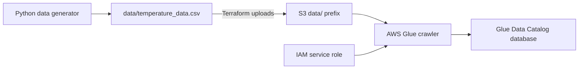

# DevOps Data Engineering Automation

A small Python and Terraform project that generates synthetic temperature observations, uploads them to Amazon S3, and provisions an AWS Glue crawler and Data Catalog database. The repository also includes Python tests and a GitHub Actions workflow definition for security scanning, testing, infrastructure validation, planning, and deployment.

## Architecture



Terraform provisions the infrastructure and uploads the CSV. The crawler discovers its schema when it runs. This project does not include a Glue ETL job, an Athena query workflow, or a scheduler for regenerating the CSV.

## Repository layout

```text
.
├── .gitignore
├── README.md
├── .bandit                        # Bandit configuration
├── data/
│   └── temperature_data.csv        # Sample input uploaded by Terraform
├── .github/
│   └── workflows/
│       └── deploy.yml              # Checks and shared-state deployment
├── requirements.txt
├── scripts/
│   ├── __init__.py
│   └── generate_sample_data.py
├── terraform/
│   ├── .terraform.lock.hcl          # Provider dependency lock file
│   ├── main.tf
│   ├── output.tf
│   ├── provider.tf
│   ├── variables.tf
│   ├── tests/infrastructure.tftest.hcl # Mocked deployment-mode tests
│   ├── backend.tfbackend.example
│   └── terraform.tfvars.example
└── tests/
    ├── __init__.py
    └── test_generate_sample_data.py
```

## Prerequisites

- Python and `pip`. The workflow specifies Python 3.10.
- Terraform 1.10 or newer, below 2.0. The workflow specifies Terraform 1.12.2 to support S3 state locking and mocked infrastructure tests.
- An AWS account and credentials with permission to manage the configured S3, IAM, and Glue resources.
- AWS CLI for the optional identity, crawler, and upload verification commands below.

The AWS provider constraint is `~> 5.0`. Keep `terraform/.terraform.lock.hcl` in version control so provider selections are reproducible.

## Local setup

Run these commands from the repository root:

```bash
python3 -m venv venv
source venv/bin/activate
python -m pip install --upgrade pip
python -m pip install -r requirements.txt
```

On Windows PowerShell, activate the environment with `venv\Scripts\Activate.ps1`.

The dependency file includes `pytest`, `pytest-cov`, and Bandit for development and CI. The CSV generator uses only Python's standard library; unused AWS SDK and mocking dependencies have been removed.

## Generate sample data

```bash
python scripts/generate_sample_data.py
```

This creates or overwrites `data/temperature_data.csv` with a header and 10,000 observations. The default destination is relative to the repository, even when the script is invoked from another directory. Parent directories are created automatically.

CLI options let you select the output and record count:

```bash
python scripts/generate_sample_data.py --output data/custom_temperature.csv --records 500
```

| Column | Contents |
| --- | --- |
| `City` | New York, London, Tokyo, Paris, or Sydney |
| `Temperature` | Synthetic degrees Celsius between 10 and 35, rounded to one decimal place |
| `timestamp` | ISO-formatted UTC timestamp, offset by a random 0–365 days from generation time |

Temperature values represent degrees Celsius. Newly generated timestamps include a `+00:00` UTC offset. The checked-in sample predates that convention; regenerate it to obtain UTC timestamps. Generation is random and does not set a seed, so repeated runs produce different files.

To choose a file and record count:

```python
from scripts.generate_sample_data import generate_temperature_csv

generate_temperature_csv("data/custom_temperature.csv", num_records=500)
```

A count of zero produces a header-only CSV; a negative count raises `ValueError`, and non-integer counts raise `TypeError`. Filesystem errors retain their native exception types, including `IsADirectoryError`. Terraform always reads `data/temperature_data.csv`, so generating a different filename does not change its upload source.

## Run tests and security checks

```bash
python -m pytest tests/ -v
python -m pytest tests/ -v --cov=scripts --cov-report=term-missing --cov-report=xml --cov-fail-under=90
```

The tests cover file creation, headers, row counts, supported cities, temperature bounds, UTC timestamp ranges, nested directories, invalid input without overwriting existing files, native filesystem errors, and CLI invocation outside the repository. CI requires at least 90% Python coverage.

Mocked Terraform tests cover new and existing buckets, public-access protection, safe deletion defaults, project naming, upload destinations, and scoped S3 access. They do not require AWS credentials:

```bash
terraform -chdir=terraform init -backend=false -lockfile=readonly
terraform -chdir=terraform validate
terraform -chdir=terraform test
```

Run the security scan:

```bash
python -m bandit -r scripts -c .bandit
```

The configuration skips `B311` because the random generator produces synthetic observations, not secrets. Tests and virtual environments are excluded.

## Configure AWS access

Configure credentials using your normal AWS authentication method. For a named local profile:

```bash
aws configure --profile temperature-dev
export AWS_PROFILE=temperature-dev
aws sts get-caller-identity
```

Use the same profile for planning, applying, and destroying resources. Do not commit credentials. `.gitignore` excludes local `.aws/`, `.env` files, and Terraform variable files.

## Terraform configuration

| Variable | Default | Purpose |
| --- | --- | --- |
| `aws_region` | `eu-north-1` | AWS deployment region |
| `project_name` | `dml-temperature-analysis` | Prefix for the new bucket and catalog database |
| `use_existing_bucket` | `false` | Reuse an existing bucket when enabled |
| `existing_bucket_name` | `dml-temperature-analysis-raw-data` | Bucket looked up when reuse is enabled |
| `force_destroy` | `false` | Opt in to deleting a non-empty created bucket and all object versions |

For a new bucket, its name is `<project_name>-raw-data`. Bucket names must be globally unique. The Glue database name is `<project_name>_temperature_analysis`, with hyphens replaced by underscores.

The IAM role name is `AWSGlueServiceRole-<project_name>` and the crawler name is `<project_name>-crawler`. The default names remain compatible with the original configuration. The name length limit also keeps the prefixed IAM role within its 64-character limit. Use distinct project names and state keys for separate deployments. `project_name` accepts 3–45 lowercase letters, digits, and hyphens, beginning and ending with a letter or digit.

Copy `terraform/terraform.tfvars.example` to `terraform/terraform.tfvars` and edit it, or create your own:

```hcl
aws_region   = "eu-north-1"
project_name = "your-unique-temperature-project"
```

To reuse a bucket instead:

```hcl
aws_region           = "eu-north-1"
use_existing_bucket  = true
existing_bucket_name = "your-existing-bucket"
```

In reuse mode, Terraform looks up the bucket and manages the two uploaded objects, but does not manage its versioning, encryption, or public-access configuration. The uploader needs permission to write those keys. If the bucket uses a customer-managed KMS key, grant the deployment identity and crawler role the corresponding KMS permissions separately.

## Shared Terraform state

The configuration uses an S3 backend with native state locking. Provision a **separate** state bucket before initializing the deployment; do not use the raw-data bucket, whose lifecycle is managed by this configuration. The state bucket should have versioning, encryption, and all public access blocked.

For example, after choosing a globally unique name, provision it once with the AWS CLI (these commands create AWS resources):

```bash
STATE_BUCKET=your-unique-terraform-state-bucket
aws s3api create-bucket --bucket "$STATE_BUCKET" --region eu-north-1 \
  --create-bucket-configuration LocationConstraint=eu-north-1
aws s3api put-bucket-versioning --bucket "$STATE_BUCKET" \
  --versioning-configuration Status=Enabled
aws s3api put-bucket-encryption --bucket "$STATE_BUCKET" \
  --server-side-encryption-configuration '{"Rules":[{"ApplyServerSideEncryptionByDefault":{"SSEAlgorithm":"AES256"}}]}'
aws s3api put-public-access-block --bucket "$STATE_BUCKET" \
  --public-access-block-configuration BlockPublicAcls=true,IgnorePublicAcls=true,BlockPublicPolicy=true,RestrictPublicBuckets=true
```

These creation commands assume `eu-north-1`; adapt them for other regions (S3 creation in `us-east-1` omits the location constraint). Keep this bucket after application cleanup to preserve state history.

Copy `terraform/backend.tfbackend.example` to `terraform/backend.tfbackend`, set the bucket, key, and region, then initialize using that file. Local backend files are ignored by Git. Never put credentials in backend configuration.

The deployment identity needs `s3:ListBucket` on the state bucket, `s3:GetObject` and `s3:PutObject` on the state key, and `s3:GetObject`, `s3:PutObject`, and `s3:DeleteObject` on its `.tflock` key. Additional permissions are needed if state encryption uses KMS. See [HashiCorp's S3 backend documentation](https://developer.hashicorp.com/terraform/language/backend/s3).

For an existing deployment with local state, back up that state and use `terraform -chdir=terraform init -migrate-state -backend-config=backend.tfbackend` to migrate it. Ensure local and CI operations use the same bucket, key, and variables. Do not initialize an empty state against resources already managed elsewhere.

## Validate and deploy

Generate the CSV before planning: Terraform evaluates `filemd5` on that file and needs it to exist.

```bash
python scripts/generate_sample_data.py
terraform -chdir=terraform init -backend-config=backend.tfbackend
terraform -chdir=terraform fmt -check
terraform -chdir=terraform validate
terraform -chdir=terraform plan -lock-timeout=5m -out=tfplan
terraform -chdir=terraform apply -lock-timeout=5m tfplan
```

Review the plan before applying it. Provisioned resources can incur AWS charges.

With the default new-bucket configuration, Terraform creates:

- An S3 bucket with versioning, AES256 server-side encryption, all public access blocked, and `Environment = dev` tagging.
- A `data/` prefix marker and `data/temperature_data.csv` object. A source hash detects CSV changes for subsequent applies.
- An IAM role trusted by AWS Glue, with the `AWSGlueServiceRole` managed policy and an inline S3 read policy scoped to the selected bucket's `data/` prefix.
- A Glue Data Catalog database and a crawler targeting the S3 `data/` prefix.

The crawler schedule is `cron(0 1 * * ? *)`, corresponding to daily execution at 01:00 UTC. It recrawls everything, updates discovered schemas in the catalog, and logs deletions. Applying Terraform does not explicitly start a crawler run.

The crawler retains the [AWS-managed Glue service-role policy](https://docs.aws.amazon.com/glue/latest/dg/create-service-policy.html) for Glue, logging, and bucket metadata operations. The additional inline policy grants only bucket listing under `data/` and reads of `data/*`.

## Verify the deployment

`raw_bucket_name` and `bucket_name` expose the same bucket name; `crawler_name` and `catalog_database_name` identify Glue resources:

```bash
terraform -chdir=terraform output
terraform -chdir=terraform output -raw raw_bucket_name
terraform -chdir=terraform output -raw bucket_name
```

To inspect the upload and manually start the configured crawler:

```bash
BUCKET_NAME=$(terraform -chdir=terraform output -raw raw_bucket_name)
CRAWLER_NAME=$(terraform -chdir=terraform output -raw crawler_name)
aws s3 ls "s3://${BUCKET_NAME}/data/" --region eu-north-1
aws glue start-crawler \
  --name "$CRAWLER_NAME" \
  --region eu-north-1
aws glue get-crawler \
  --name "$CRAWLER_NAME" \
  --region eu-north-1
```

Replace the region if you changed `aws_region`. Once the crawler finishes, inspect its run details and discovered tables in the AWS Glue console. Catalog tables are created by crawler execution, not declared as Terraform resources.

## CI/CD workflow

The active workflow is `.github/workflows/deploy.yml`, in [GitHub's workflow directory](https://docs.github.com/en/actions/reference/workflows-and-actions/workflow-syntax). Pull requests and pushes targeting `main` run security scanning, Python tests with coverage, Terraform formatting/validation, and mocked infrastructure tests. A manual dispatch is also available.

Successful pushes to `main`, and manual runs on `main`, continue to the `production` environment. Configure environment protection rules if human review is required before that job starts. The job generates fresh data, plans, and applies the saved plan on the **same runner**, using shared remote state. Deployment runs are serialized and an active apply is not cancelled by a newer run.

Configure these repository or `production` environment settings before deploying:

| Setting | Type | Purpose |
| --- | --- | --- |
| `AWS_ACCESS_KEY_ID` | Secret | AWS deployment credential |
| `AWS_SECRET_ACCESS_KEY` | Secret | AWS deployment credential |
| `TF_STATE_BUCKET` | Variable, required | Separately provisioned shared state bucket |
| `TF_STATE_REGION` | Variable, optional | State bucket region; defaults to `eu-north-1` |
| `TF_STATE_KEY` | Variable, optional | State key; defaults to `temperature-analysis/terraform.tfstate` |
| `PROJECT_NAME` | Variable, optional | Deployment name; defaults to `dml-temperature-analysis` |
| `USE_EXISTING_BUCKET` | Variable, optional | `true` to reuse an existing bucket; defaults to `false` |
| `EXISTING_BUCKET_NAME` | Variable, optional | Existing bucket name when reuse is enabled |

The target AWS region is set through workflow `AWS_REGION` and `TF_VAR_aws_region`; update both together if changing it. The credentials require infrastructure-management permissions and the state permissions described above. This workflow uses access-key secrets; role-based OIDC authentication can be adopted separately.

Coverage and Terraform outputs are retained for seven days. State and saved plans are not uploaded as workflow artifacts. The workflow does not create the state bucket or start the Glue crawler immediately after applying.

## Cleanup

Use the same initialized backend, AWS account, region, and variable values used for deployment:

```bash
terraform -chdir=terraform plan -destroy
terraform -chdir=terraform destroy
```

The created bucket defaults to `force_destroy = false`. A non-empty versioned bucket can prevent destruction even after Terraform removes its current managed objects. Empty it deliberately, or explicitly set `force_destroy = true` and review the destruction plan before retrying. That opt-in can delete every object version and files added outside this project.

When reusing an existing bucket, the bucket itself is not destroyed, but Terraform removes the S3 objects it manages along with the IAM and Glue resources. Preserve remote state and the separate state bucket; the application destroy command does not remove that bucket.

## Troubleshooting

| Symptom | Check or action |
| --- | --- |
| `No module named pytest` | Activate the virtual environment and install `requirements.txt`. |
| Missing CSV or `filemd5` error | Run the generator from the repository root before planning. |
| S3 bucket name already taken | Set a globally unique `project_name`, or select an existing bucket. |
| IAM role or crawler already exists | Check `project_name` and the existing deployment/state before changing or importing resources. |
| AWS access denied or missing credentials | Verify the active identity and permissions using `aws sts get-caller-identity`. |
| No Glue tables after apply | Start the crawler, wait for completion, and inspect its run status and permissions. |
| Backend initialization requests missing settings | Create `backend.tfbackend` from the example and supply it with `-backend-config`. |
| CI reports missing state configuration | Set `TF_STATE_BUCKET` and provision the bucket before rerunning deployment. |
| State lock cannot be acquired | Check lock-file permissions and active operations; do not remove a lock while an apply is running. |
| Destroy cannot delete the versioned bucket | Review retained versions and the explicit `force_destroy` option. |

## Scope and maintenance

Keep source files, tests, the sample CSV, and the Terraform provider lock file in version control. Virtual environments, caches, local secrets, Terraform state, and `*.tfplan` files are ignored. Local backend configuration, the extensionless `tfplan`, and generated `terraform_outputs.json` are also ignored. Example variable and backend files remain versioned.

No license file is currently included in this repository.
